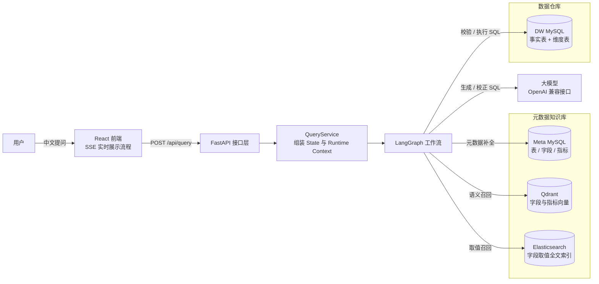
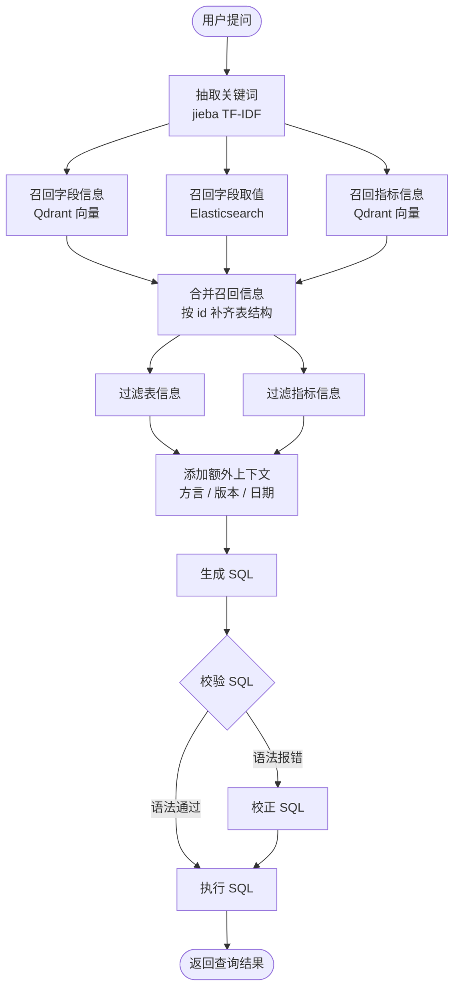

# Shopkeeper Agent · 电商问数智能体

> 用一句话提问，帮你把数据查出来。

一个基于 **FastAPI + LangGraph + RAG** 的自然语言问数（NL2SQL）系统。用户输入中文问题，系统先从元数据知识库里召回表、字段、指标与字段取值，组装成适合大模型理解的上下文，再由大模型生成 SQL，经过校验与自动纠错后到数据仓库执行，最终把结果返回前端。

前端不是干等结果，而是通过 **SSE** 实时展示 LangGraph 工作流每一个节点的执行状态：抽取关键词 → 召回字段/取值/指标 → 合并召回 → 过滤上下文 → 生成 SQL → 校验 SQL → 执行 SQL。


---

## 目录

- [项目简介](#项目简介)
- [核心能力](#核心能力)
- [技术栈](#技术栈)
- [系统架构](#系统架构)
- [Agent 工作流](#agent-工作流)
- [目录结构](#目录结构)
- [快速开始](#快速开始)
- [接口说明](#接口说明)
- [元数据知识库是怎么建起来的](#元数据知识库是怎么建起来的)
- [技术亮点](#技术亮点)
- [常见问题](#常见问题)

---

## 项目简介

传统 BI 报表要靠人先知道字段叫什么、指标怎么算，才能拖出一张图。这套系统想解决的是另一件事：**让业务人员直接用中文把问题问出来。**

它的难点从来不在「让大模型写 SQL」，而在于三件事：

1. 大模型不认识你的库 —— 表名、字段名、指标口径、字段里的真实取值，它一概不知；
2. 库里字段往往有大量业务别名（「销售额」= `order_amount`，「大区」= `region_name`），光靠字面匹配召回不到；
3. 大模型生成的 SQL 不保证一次就对，需要有个能自己发现错误并修回来的闭环。

因此这个项目的核心工作量在**上下文工程**上：把元数据整理成知识库（结构化元数据 + 向量索引 + 全文索引），在提问时多路召回、合并、过滤，最后才交给大模型生成 SQL。

## 核心能力

- **自然语言问数**：中文提问直出结果表格，支持聚合、分组、排序、TopN 等常见分析场景
- **多路召回**：字段走 Qdrant 向量语义检索，字段取值走 Elasticsearch 全文检索（IK 中文分词），指标走向量检索，三路各取所长
- **上下文工程**：召回结果合并 → 二次过滤（只留下与问题真正相关的表/指标）→ 补齐数据库方言、版本、当前日期等信息
- **SQL 自愈闭环**：生成 SQL 后先在数仓中做解析校验，语法不通过则自动带着报错信息重写，最多一轮校正后执行
- **过程可视化**：工作流每个节点通过 `stream_mode="custom"` 向前端推送 `running / success / error` 状态，前端以步骤条实时呈现
- **全链路日志追踪**：基于 `contextvars` + `loguru.patch` 给每个请求注入 `request_id`，一次请求的所有日志可按 ID 串起来
- **工程化分层**：接口层 / 服务层 / 仓储层 / 客户端层清晰分离，依赖统一在 `dependencies.py` 组装，测试与替换成本低

## 技术栈

| 层次 | 技术选型 |
| --- | --- |
| 后端框架 | FastAPI（`StreamingResponse` 输出 SSE）、Uvicorn |
| Agent 编排 | LangGraph（`StateGraph` + Runtime Context + 条件边）、LangChain |
| 大模型 | OpenAI 兼容协议（默认智谱 GLM，可换 SiliconFlow / DeepSeek 等） |
| 向量检索 | Qdrant（字段集合、指标集合分开管理） |
| 全文检索 | Elasticsearch 8.19.10 + IK 中文分词插件 |
| 向量化 | HuggingFace Text Embeddings Inference（TEI）+ `BAAI/bge-large-zh-v1.5`（1024 维） |
| 关键词抽取 | jieba TF-IDF（按词性过滤，减少无检索价值的噪声词） |
| 元数据存储 | MySQL 8.0 + SQLAlchemy 2.0 Async + asyncmy |
| 配置管理 | OmegaConf + python-dotenv（YAML 结构化配置 + 环境变量注入敏感信息） |
| 日志 | Loguru（控制台 + 文件轮转，注入 request_id） |
| 前端 | React 19 + TypeScript + Vite 6 + Tailwind CSS 3.4 + lucide-react |
| 环境编排 | Docker Compose（MySQL / Elasticsearch / Kibana / Qdrant / TEI） |

## 系统架构



分工上的一句话总结：

- **Meta MySQL** 存「有哪些表、哪些字段、什么口径」——结构化事实
- **Qdrant** 存「这个问题的说法，和哪个字段/指标语义最像」——语义召回
- **Elasticsearch** 存「'华东' 到底是哪个字段的哪个值」——精确取值对齐
- **DW MySQL** 存真实业务数据，只负责最后的 SQL 执行

## Agent 工作流



12 个节点的职责：

| 节点 | 做什么 |
| --- | --- |
| `extract_keywords` | 从问题里抽取业务关键词，按词性过滤掉「帮我、一下」这类噪声；并把原始问题本身作为兜底检索入口 |
| `recall_column` | 关键词向量化后到 Qdrant 检索候选字段 |
| `recall_value` | 关键词到 Elasticsearch 检索字段真实取值，把「华东」这类口语对齐到 `region_name = '华东'` |
| `recall_metric` | 关键词向量化后到 Qdrant 检索候选指标（GMV、AOV 等） |
| `merge_retrieved_info` | 三路召回结果按 id 去重合并，并回 Meta MySQL 补齐字段所属表、数据类型等结构信息 |
| `filter_table` | 二次筛选：从候选表里挑出真正与问题相关的表，压缩提示词体积 |
| `filter_metric` | 二次筛选：挑出真正相关的指标口径，避免指标串味 |
| `add_extra_context` | 补齐数据库方言、版本、当前日期/星期/季度等模型容易算错的上下文 |
| `generate_sql` | 拼装完整提示词，调用大模型生成 SQL |
| `validate_sql` | 交给真实数仓解析 SQL；结果写入 `state["error"]`，由条件边决定后续走向 |
| `correct_sql` | 带着数据库返回的报错信息重写 SQL，实现自愈 |
| `run_sql` | 执行最终 SQL，把结果作为 `result` 事件推给前端 |

设计上有两个关键点：

**State 与 Context 分离。** 业务数据（关键词、召回结果、SQL）放在 `DataAgentState` 里参与节点间的状态合并；而数据库会话、向量库客户端这些外部依赖放在 Runtime Context 中，通过 `runtime.context` 读取，不参与状态合并 —— 既避免了不可序列化对象污染状态，也让节点可以复用连接而不是每次重建。

**并行召回 + 条件分支。** `extract_keywords` 之后三条召回边并行发散、再汇聚到 `merge_retrieved_info`；`validate_sql` 之后用条件边根据 `state["error"]` 分流到「直接执行」或「先校正再执行」。

## 目录结构

```
shopkeeper-agent/
├── main.py                          # FastAPI 入口，注册路由与 request_id 中间件
├── pyproject.toml                   # 依赖声明（uv 管理）
├── .env.example                     # 大模型 API Key 示例
├── app/
│   ├── agent/                       # Agent 核心
│   │   ├── graph.py                 # StateGraph 编排：节点、边、条件边
│   │   ├── state.py                 # 节点间共享状态定义
│   │   ├── context.py               # Runtime Context：外部依赖容器
│   │   ├── llm.py                   # 大模型实例（OpenAI 兼容）
│   │   └── nodes/                   # 12 个工作流节点
│   ├── api/                         # 接口层
│   │   ├── lifespan.py              # 启动/关闭时初始化与释放各类客户端
│   │   ├── dependencies.py          # 依赖组装（Session → Repository → Service）
│   │   ├── routers/query_router.py  # POST /api/query（SSE）
│   │   └── schemas/query_schema.py  # 请求体模型
│   ├── clients/                     # 外部服务客户端管理器（MySQL / Qdrant / ES / Embedding）
│   ├── repositories/                # 仓储层
│   │   ├── mysql/meta/              # 元数据读写（含实体转换 Mapper）
│   │   ├── mysql/dw/                # 数仓读取、SQL 校验与执行
│   │   ├── qdrant/                  # 字段、指标向量检索
│   │   └── es/                      # 字段取值全文检索
│   ├── services/                    # 业务编排
│   │   ├── query_service.py         # 一次问数：组装 Context、消费流式输出、包装 SSE
│   │   └── meta_knowledge_service.py# 元数据知识库构建
│   ├── entities/                    # 领域实体（TableInfo / ColumnInfo / MetricInfo / ValueInfo）
│   ├── models/                      # SQLAlchemy ORM 映射
│   ├── conf/                        # 配置加载（app_config / meta_config）
│   ├── core/                        # 日志与请求上下文
│   ├── prompt/prompt_loader.py      # 提示词加载器
│   └── scripts/build_meta_knowledge.py  # 知识库构建脚本入口
├── prompts/                         # 6 个提示词模板（关键词扩展、过滤、SQL 生成与校正）
├── conf/
│   ├── app_config.yaml              # 基础设施与模型配置
│   └── meta_config.yaml             # 表、字段、指标的口径定义（知识库唯一数据源）
├── docker/
│   ├── docker-compose.yaml          # MySQL / ES / Kibana / Qdrant / TEI
│   ├── mysql/meta.sql               # 元数据库建表脚本
│   ├── mysql/dw.sql                 # 示例电商数仓（1 事实表 + 4 维度表）
│   └── elasticsearch/Dockerfile     # 内置 IK 中文分词插件的 ES 镜像
├── examples/qdrant_quickstart_demo.py
└── frontend/                        # React 前端
    ├── src/App.tsx                  # 会话状态、SSE 事件消费与页面布局
    ├── src/components/              # Composer / MessageBubble / StepRail / ResultTable / EmptyState
    ├── src/lib/agentApi.ts          # SSE 流式请求与事件解析
    └── src/types/agent.ts           # 事件与消息类型定义
```

## 快速开始

### 0. 环境要求

- Python 3.12 + [uv](https://docs.astral.sh/uv/)
- Node.js 18+ + pnpm
- Docker Desktop（内存建议 8G 以上，TEI + ES + Kibana 比较吃资源）

### 1. 先准备两个大文件

这两个文件体积过大没有入库，需要手动放到对应位置，否则 ES 镜像构建和向量服务会起不来。

**① 中文向量模型**（约 1.3G）→ `docker/embedding/bge-large-zh-v1.5/`

```bash
huggingface-cli download BAAI/bge-large-zh-v1.5 \
  --local-dir docker/embedding/bge-large-zh-v1.5
```

**② IK 中文分词插件**（约 4.5M）→ `docker/elasticsearch/plugins/elasticsearch-analysis-ik-8.19.10.zip`

到 [analysis-ik Releases](https://github.com/infinilabs/analysis-ik/releases/tag/v8.19.10) 下载对应版本，注意文件名要和路径一致。

### 2. 启动基础服务

```bash
cd docker
docker compose up -d
```

| 服务 | 端口 | 说明 |
| --- | --- | --- |
| MySQL | 3307 → 3306 | 初始化时自动执行 `meta.sql` 与 `dw.sql`，建好元数据库与示例数仓 |
| Elasticsearch | 9200 | 内置 IK 分词插件 |
| Kibana | 5601 | 可选，方便查看 ES 索引 |
| Qdrant | 6333 / 6334 | 向量库 |
| TEI Embedding | 8081 | bge-large-zh-v1.5 向量化服务 |

### 3. 配置

```bash
cp .env.example .env
```

在 `.env` 里填上自己的大模型 API Key：

```bash
LLM_API_KEY=你的_API_Key
```

`conf/app_config.yaml` 里定义基础设施与模型参数，其中 LLM 部分是 OpenAI 兼容协议，换供应商只需要改 `model_name` 和 `base_url`：

```yaml
llm:
  model_name: glm-5.3
  api_key: ${oc.env:LLM_API_KEY}   # 敏感信息走 .env，不写进仓库
  base_url: https://open.bigmodel.cn/api/paas/v4
```

> 数据库端口默认按 `docker-compose.yaml` 的映射配成 **3307**，如果改了映射记得同步 `db_meta` / `db_dw` 的 `port`。

### 4. 构建元数据知识库

```bash
uv sync
uv run python -m app.scripts.build_meta_knowledge -c conf/meta_config.yaml
```

这一步会把 `conf/meta_config.yaml` 中声明的表、字段、指标：

- 结构化写入 Meta MySQL 的 `table_info` / `column_info` / `metric_info` / `column_metric`
- 按「字段名 + 描述 + 每个别名」分别生成向量点，写入 Qdrant 的字段集合与指标集合
- 把标记了 `sync: true` 的维度字段的真实取值写入 Elasticsearch 全文索引

> 字段与指标变更后重跑一次即可，知识库内容完全由配置文件驱动。

### 5. 启动后端

```bash
uv run uvicorn main:app --reload --port 8000
```

接口文档：<http://127.0.0.1:8000/docs>

### 6. 启动前端

```bash
cd frontend
pnpm install
pnpm dev
```

打开 <http://localhost:5173>，Vite 已配置把 `/api` 代理到 `http://127.0.0.1:8000`。想改后端地址就在 `frontend/.env` 里调整 `VITE_DEV_PROXY_TARGET`。

可以试试这几个问题：

- 统计 2025 年第一季度各大区的 GMV，并按 GMV 从高到低排序
- 统计 2025 年 3 月各商品品类的销量和销售额
- 查询华东地区 2025 年第一季度销售额最高的前 5 个商品
- 按会员等级统计 2025 年第一季度的订单数和销售额

## 接口说明

### `POST /api/query`

请求体：

```json
{ "query": "统计 2025 年第一季度各大区的 GMV，并按 GMV 从高到低排序" }
```

响应为 `text/event-stream`，每条事件是一行 `data: {json}`，用两个换行分隔。命令行验证：

```bash
curl -N -X POST http://127.0.0.1:8000/api/query \
  -H "Content-Type: application/json" \
  -d '{"query":"统计 2025 年第一季度各大区的 GMV，并按 GMV 从高到低排序"}'
```

事件共三种：

| 类型 | 结构 | 说明 |
| --- | --- | --- |
| `progress` | `{"type":"progress","step":"生成SQL","status":"running"}` | 节点执行状态，`status` 取值 `running` / `success` / `error` |
| `result` | `{"type":"result","data":[{...}]}` | 最终查询结果集 |
| `error` | `{"type":"error","message":"..."}` | 链路异常 |

`progress` 事件的 `step` 依次为：`抽取关键词` → `召回字段信息` / `召回字段取值` / `召回指标信息` → `合并召回信息` → `过滤表信息` / `过滤指标信息` → `添加额外上下文` → `生成SQL` → `校验SQL` → （`校正SQL`）→ `执行SQL`。

前端 `agentApi.ts` 用 `fetch` + `ReadableStream` 逐块读取、按 `\n\n` 切分事件再做 JSON 解析，解析失败会降级成 `error` 事件而不是整条链路崩掉。

## 元数据知识库是怎么建起来的

这是整个系统里最值得看的部分 —— **它决定了模型能不能"听懂人话"**。

以 `order_amount` 这个字段为例，配置里长这样：

```yaml
- name: order_amount
  role: measure
  description: 订单金额。
  alias: [销售额, 订单金额, 收入]
  sync: false
```

构建时一个字段会裂成 **多个向量点**：

```
"order_amount"   → 向量（精确匹配英文字段名）
"订单金额。"      → 向量（语义匹配描述）
"销售额" / "订单金额" / "收入" → 各生成一个向量（业务口语别名）
```

这样用户说「帮我看看收入」，即使问题里没有出现 `order_amount`，也能命中。检索时按 payload 里的字段 id 去重合并，就回到同一个字段上。

指标同理（GMV / AOV 这类需要口径计算的），并且 `column_metric` 表单独维护「指标依赖哪些字段」的关系，方便后续做指标展开。

至于字段取值 —— 那类「华东」「黄金会员」这种**必须精确对齐**的东西，走向量检索反而不靠谱，所以改成 Elasticsearch 全文检索 + IK 中文分词，把维度字段的真实取值（最多取 10 万条）建成索引，用户说「华东」就能直接定位到 `region_name = '华东'`，避免大模型在 `WHERE` 条件里瞎编。

`sync: true` 的字段才会同步取值，主键和外键这类高基数字段不同步，控制索引体积。

## 技术亮点

1. **State / Context 分离的依赖注入**：LangGraph 的 Runtime Context 承载数据库会话与向量库客户端，业务数据才进 State，节点通过 `runtime.context` 复用连接，避免了把连接对象塞进状态导致序列化问题。
2. **一实体多向量入口**：字段与指标的「名称 / 描述 / 别名」分别向量化，显著提升业务口语的召回率。
3. **三路异构召回**：语义理解走向量（Qdrant），精确取值走全文索引（ES + IK），按数据特性选检索方式，而不是一套向量打天下。
4. **两段式上下文压缩**：先多路召回（召回率高），再合并后二次过滤（精度高、提示词短），兼顾召回与成本。
5. **SQL 自愈闭环**：`validate_sql` 把语法校验结果写进 `state["error"]`，由条件边决定是直接执行还是送进 `correct_sql` 重写，把「一次生成」变成「生成—校验—修正」的闭环。
6. **自定义流式协议**：节点内用 `runtime.stream_writer` 以 `stream_mode="custom"` 上报进度，服务层统一包装为 SSE；前端 `StepRail` 组件把过程可视化成步骤条，解决 Agent 黑盒体验。
7. **全链路 request_id**：`contextvars` 保证并发协程间互不干扰，`loguru.patch` 自动注入到每条日志，出问题能按请求回溯。
8. **配置驱动的知识库**：表、字段、指标、别名、是否同步取值全部写在 `meta_config.yaml`，改元数据不用改代码。

## 常见问题

**ES 容器构建失败，提示找不到插件包？**
`docker/elasticsearch/plugins/` 下的 IK 插件 zip 没有入库，需要先按 [第 1 步](#1-先准备两个大文件) 下载再执行 `docker compose up -d --build`。

**embedding 容器起来就退出？**
`docker/embedding/bge-large-zh-v1.5/` 里没有模型文件（该目录约 1.3G，已被 gitignore），用 `huggingface-cli` 下载后重启容器。

**连不上 MySQL？**
确认用的是 compose 映射出来的 **3307** 端口，并同步修改 `conf/app_config.yaml` 中 `db_meta.port` 与 `db_dw.port`。

**召回结果为空 / 生成的 SQL 字段名是编的？**
元数据知识库没构建或构建后元数据已过期，重跑第 4 步的构建脚本。

**生成 SQL 报模型调用失败？**
检查 `.env` 里的 `LLM_API_KEY` 是否填了、有没有额度，以及 `base_url` 与 `model_name` 是否匹配同一家供应商（本项目用 OpenAI 兼容协议，可自由切换）。

---

如果这个项目对你有帮助，欢迎 Star ⭐
