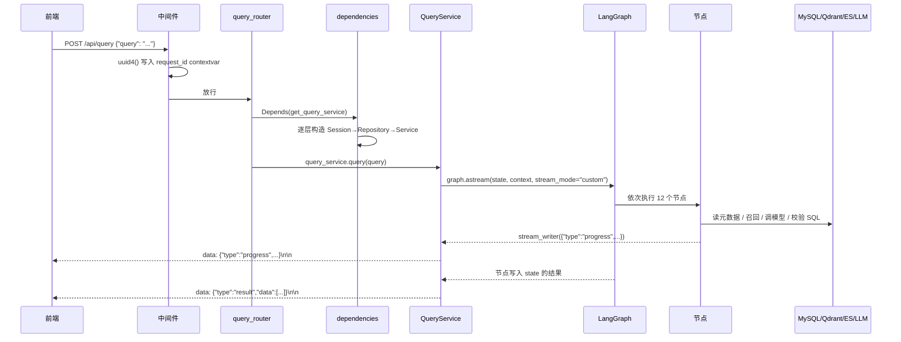

# 架构说明

这篇讲「一次提问在进程里走了哪些层」，比 README 的架构图更细一层。所有描述都对应仓库里的实际代码，文件路径可以直接核对。

## 分层与职责

```
接口层   app/api/        路由、请求模型、依赖组装
服务层   app/services/   一次问数的编排：构造 State / Context、消费流、包装 SSE
编排层   app/agent/      LangGraph 图、节点、共享状态、运行时上下文
仓储层   app/repositories/  MySQL(meta/dw) / Qdrant / ES 的读写
客户端层 app/clients/     连接池与客户端生命周期（lifespan 初始化，进程内单例）
```

依赖方向是单向的：**接口层 → 服务层 → 编排层 → 仓储层 → 客户端层**。仓储层不知道上面有 Agent，节点也不知道 HTTP 存在 —— 所以 `app/agent/graph.py` 可以直接在 `__main__` 里跑一个测试问题，不需要起 FastAPI。

## 一次请求的生命周期

以 `POST /api/query` 为例：



拆开看几个关键点：

**① 中间件只做一件事**（`main.py`）：生成 `uuid4`，写进 `app/core/context.py` 的 `request_id_ctx_var`。之后任意深度的日志都会带上这个 id，靠的是 `loguru.patch`，不需要一层层传参。

**② 依赖是递归组装出来的**（`app/api/dependencies.py`）：`get_query_service` 声明自己需要 6 个对象，其中 2 个来自 `get_meta_mysql_repository` / `get_dw_mysql_repository`，这两个又各需要一个 Session。FastAPI 顺着声明往上找，最终 `async with session_factory()` 在请求结束时自动归还连接。路由函数本身只写 `Depends`，不碰连接。

**③ 每次请求两个独立 Session**：`db_meta` 和 `db_dw` 各一个。元数据库只读元数据，数仓只执行 SQL，互不干扰。

**④ 向量库和 ES 客户端是进程级共享的**：在 `app/api/lifespan.py` 里初始化一次，`dependencies.py` 直接返回 manager 上挂着的对象，不按请求创建。

## 为什么 State 和 Context 要分开

这是 LangGraph 用法里最容易搞混的一处，也是本项目刻意做的设计：

| | `DataAgentState` | `DataAgentContext` |
| --- | --- | --- |
| 放什么 | 关键词、召回结果、SQL、错误信息 | 数据库 Session、Qdrant/ES 客户端、Embedding 客户端 |
| 参与状态合并 | 是（节点返回的部分字典会合并进 State） | 否 |
| 跨节点传递 | 自动 | 通过 `runtime.context` 读取 |
| 能否序列化 | 能（都是 dict / list / str） | 不能（含连接对象） |

如果把 Session 塞进 State，LangGraph 合并状态时会碰到不可序列化对象，而且每经过一个节点都可能被复制一份。分开之后，节点里统一写：

```python
dw: DWMySQLRepository = runtime.context["dw_mysql_repository"]
```

连接只建立一次，12 个节点共享。

## 图的形状

12 个节点、3 段并行、1 个条件分支：

```
START → extract_keywords
          ├→ recall_column ─┐
          ├→ recall_value  ─┤→ merge_retrieved_info
          └→ recall_metric ─┘
                                ├→ filter_table  ─┐
                                └→ filter_metric ─┤→ add_extra_context
                                                    → generate_sql
                                                    → validate_sql
                                                        ├─ error == None → run_sql → END
                                                        └─ error != None → correct_sql → run_sql → END
```

条件边的判断只有一行（`app/agent/graph.py`）：

```python
path=lambda state: "run_sql" if state["error"] is None else "correct_sql"
```

**纠错只有一轮**。`correct_sql` 之后直接进 `run_sql`，不回头再校验 —— 这是刻意的：多轮纠错会让延迟不可预测，而一轮能覆盖大多数语法错误（字段名写错、函数名写错、方言不支持）。

## 并发与资源

- 全链路 `async`：MySQL 用 `asyncmy`、Qdrant 用 `AsyncQdrantClient`、ES 用 `AsyncElasticsearch`、模型走 `init_chat_model` 的异步接口
- 一次请求 = 2 个 MySQL 连接 + 1 个模型调用（生成）+ 可能 1 次（纠错）+ 若干次向量/ES 检索
- **模型调用是唯一的慢变量**：其余步骤都在毫秒级，生成 SQL 通常 2–10 秒。所以并发上限实际上由「模型 API 的并发额度」决定，而不是本地连接池

## 离线链路：知识库构建

和在线问数完全分开的第二条链路：

```
app/scripts/build_meta_knowledge.py -c conf/meta_config.yaml
        ↓
MetaKnowledgeService.build()
        ├→ 读配置（OmegaConf 校验成 MetaConfig）
        ├→ 查数仓补字段类型与样例值 → 写 Meta MySQL（4 张表）
        ├→ 字段「名称/描述/每个别名」→ 各自一个向量点 → 写 Qdrant
        ├→ sync: true 的字段 → 取真实取值（上限 10 万）→ 写 ES
        └→ 指标「名称/描述/每个别名」→ 向量点 → 写 Qdrant
```

细节和字段含义见 [元数据知识库](metadata.md)。

## 错误边界

| 位置 | 处理方式 |
| --- | --- |
| 节点内部致命异常 | 写 `progress` 事件 `status: error`，然后 `raise` |
| `QueryService.query` | `try/except` 兜住整条流，转成 `{"type":"error","message":...}` 事件 |
| 请求体不合法 | FastAPI 自动 422，不会进入图 |
| 数据库连接失败 | `lifespan` 阶段就抛，应用起不来（比运行中静默降级好） |

注意 `validate_sql` 的特殊处理：**语法错误不会中断流程**，它把错误写进 `state["error"]` 并继续 —— 由条件边决定走纠错。所以前端看到 `校验SQL success` 不代表 SQL 是对的，最终以 `result` / `error` 事件为准。